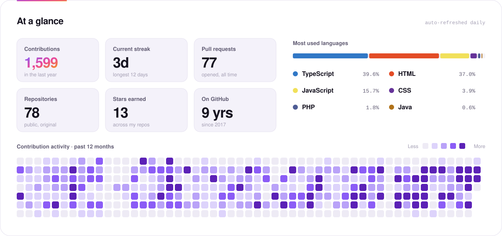

<a href="https://linkedin.com/in/nnamanikester">
  <picture>
    <source media="(prefers-color-scheme: dark)" srcset="./assets/hero-dark.svg">
    
  </picture>
</a>

 

  
  
  
  
  

 

## Hi, I'm John 👋

**I'm a software engineer.** I build complete products, from backend services and APIs to the web and mobile apps people use. I've been shipping production software for 6+ years.

**Python and TypeScript are my main languages.** I write Python every day at Turing, where I work as a Fullstack Engineer.

**I'm interested in AI engineering, data engineering and machine learning,** and in using them to make the software I build smarter.

 

## What I bring

<table>
  <tr>
    <td width="33%" valign="top">
      <h3>🧩 End-to-end products</h3>
      I own features from the database to the interface: Python, Node and NestJS services, REST and GraphQL APIs, and React and React Native apps.
    </td>
    <td width="33%" valign="top">
      <h3>⚡ Software that holds up</h3>
      I add caching to cut wasted requests, tune for performance, and set up automated testing and CI/CD so every release goes out safely.
    </td>
    <td width="33%" valign="top">
      <h3>🤖 AI that does real work</h3>
      I've built an AI-powered Slack assistant that helps engineers navigate the codebase and debug issues faster.
    </td>
  </tr>
</table>

 

## Toolbox

<table>
  <tr>
    <td width="170"><b>Languages</b></td>
    <td>
      <picture>
        <source media="(prefers-color-scheme: dark)" srcset="https://skillicons.dev/icons?i=py,ts,js,kotlin,java&theme=dark">
        
      </picture>
    </td>
  </tr>
  <tr>
    <td><b>Backend & cloud</b></td>
    <td>
      <picture>
        <source media="(prefers-color-scheme: dark)" srcset="https://skillicons.dev/icons?i=nodejs,nestjs,graphql,mongodb,redis,firebase,aws,docker&theme=dark">
        
      </picture>
    </td>
  </tr>
  <tr>
    <td><b>Frontend & mobile</b></td>
    <td>
      <picture>
        <source media="(prefers-color-scheme: dark)" srcset="https://skillicons.dev/icons?i=react,nextjs,tailwind&theme=dark">
        
      </picture>
       React, React Native and Next.js
    </td>
  </tr>
  <tr>
    <td><b>Testing & delivery</b></td>
    <td>
      <picture>
        <source media="(prefers-color-scheme: dark)" srcset="https://skillicons.dev/icons?i=jest,githubactions,git,vercel&theme=dark">
        
      </picture>
       Also Detox, Fastlane, Bitrise, CircleCI and Sentry
    </td>
  </tr>
  <tr>
    <td><b>Interested in</b> AI · data · ML</td>
    <td>
      <picture>
        <source media="(prefers-color-scheme: dark)" srcset="https://skillicons.dev/icons?i=pytorch,sklearn&theme=dark">
        
      </picture>
       AI engineering, data engineering and machine learning
    </td>
  </tr>
</table>

 

<picture>
  <source media="(prefers-color-scheme: dark)" srcset="./assets/stats-dark.svg">
  
</picture>

  

<picture>
  <source media="(prefers-color-scheme: dark)" srcset="./assets/snake-dark.svg">
  
</picture>

  

<h3 align="center">Let's build something together</h3>

  Want to talk about software, AI or data? 
  The best way to reach me is <a href="https://linkedin.com/in/nnamanikester"><b>LinkedIn</b></a>.

 

  Artwork and stats are generated by <a href="./scripts/build.mjs"><code>scripts/build.mjs</code></a> and refreshed daily by GitHub Actions.

